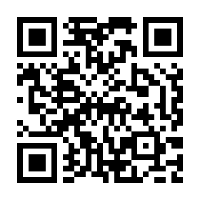

# nurse_ai

> ☕ **Buy a poor nursing student a coffee**
> 가난한 간호학생이 공부하면서 직접 만든 무료 프로그램이에요. 도움이 됐다면 커피 한 잔(1,000원)으로 응원해 주세요!
> 👉 **[카카오페이로 1,000원 후원하기](https://qr.kakaopay.com/Ej8Yr8VXm)**
>
>  💻 컴퓨터에서는 카카오페이가 안 열려요. 위 QR을 **휴대폰 카메라**로 찍어 주세요.
>
> 💬 불편한 점이나 바라는 기능은 [Issues](https://github.com/edwinedwin0716-sketch/nurse_ai/issues)에 남겨 주세요.

간호학과 공부용 프로그램 모음입니다. 모두 **인터넷·API 키 없이** 기기 안에서 동작합니다.
(AI로 다듬기는 선택 기능이며, ChatGPT·Claude 앱에 붙여넣는 방식은 구독 그대로 쓰고 API 키가 필요 없습니다.)

## 📥 바로 다운로드
👉 **[기기별 다운로드 페이지](https://edwinedwin0716-sketch.github.io/nurse_ai/)** — 프로그램 탭을 고르고 내 기기 버튼만 누르면 돼요. 설치 방법도 같이 나와요.

| 프로그램 | 📱 안드로이드 | 📱 아이폰·아이패드 | 💻 Windows 10/11 | 🍎 Mac |
|---|---|---|---|---|
| **🩺 간호과정 도우미** |  |  |  |  |
| **🗂️ 플래시카드** |  |  |  |  |
| **🍽️ 맛·볼거리** |  |  |  |  |
| **🚀 MySpace 런처** | — | — |  |   |
| **🔍 Spotlight** | — | — |  | Mac에 기본으로 있어요 |

- 안드로이드는 apk, Windows는 zip(압축 풀고 exe 실행)이에요.
- 아이폰 · Mac은 **웹앱**이에요. 사파리로 열고 아이폰은 공유 → **홈 화면에 추가**, Mac은 파일 → **Dock에 추가**하면 앱처럼 써요. (애플은 개발자 등록 없이 앱 파일 설치를 막아서 이 방식이 가장 잘 맞아요)

## 🩺 간호과정 도우미 (`NursingHelper/`)
주관적·객관적 자료를 넣으면 간호진단을 추천하고 간호과정의 큰 틀을 만들어 줍니다.

- 형식 3가지: **제출 양식**(사정 / 간호계획 및 수행 / 합리적 근거 / 간호평가, A4·표지) · **B4 워크북**(간호과정 별책 순서) · 기본 형식
- NANDA-I 2024–2026 간호진단 114개 (별책 부록 6·8 기준 진단명·영역·과·쪽수), 진단 찾기, 목록에 없는 진단 직접 입력
- Word(.doc) 저장, 제미나이 / ChatGPT / Claude로 다듬기

| 다운로드 | 설치 |
|---|---|
| 💻 Windows: [`NursingHelper-1.5.1.zip`](NursingHelper/NursingHelper-1.5.1.zip) | 압축 해제 → `NursingHelperSetup.exe` 실행 |
| 📱 Android: [`NursingHelper.apk`](NursingHelper/NursingHelper.apk) | 설치 시 "출처를 알 수 없는 앱" 허용 |
| 📱 아이폰 · 🍎 Mac: [웹앱 열기](https://edwinedwin0716-sketch.github.io/nurse_ai/nursing/) | 사파리 → 홈 화면 / Dock에 추가 |

## 🗂️ 플래시카드 학습 (`StudyHelper/`)
강의자료·필기 파일에서 **형광펜, 색·굵은 글씨, 펜 필기**를 찾아 플래시카드와 학습지를 만듭니다.

- 지원 파일: PDF(굿노트·삼성노트 필기 포함) · PPTX · DOCX · HWPX
- 카드: 빈칸 · 수치 · 용어 · 문제(5지선다·OX) · 표시한 문항
- 모름 / 애매 / 알아요 채점, 1·3·7·14·30일 복습 주기, 단원별 학습
- 같은 상위 제목("1. 고혈압"이 다시 나오는 경우 등)은 하나로 합쳐서 정리
- 학습지(요점정리·핵심 수치·지식확인 문제·정답표) Word 저장 / PDF 인쇄

| 다운로드 | 설치 |
|---|---|
| 💻 Windows 10/11: [`Flashcards-Windows-2.1.1.zip`](StudyHelper/Flashcards-Windows-2.1.1.zip) | 압축 해제 → `플래시카드.exe` (바탕화면 아이콘 생성, Edge 앱 창) |
| 🌐 아무 컴퓨터 브라우저: [`Flashcards-PC-2.1.1.zip`](StudyHelper/Flashcards-PC-2.1.1.zip) | 압축 해제 → `플래시카드.html` 더블클릭 |
| 📱 아이폰 · 🍎 Mac: [웹앱 열기](https://edwinedwin0716-sketch.github.io/nurse_ai/flashcards/) | 사파리 → 홈 화면 / Dock에 추가 |
| 📱 Android: [`StudyHelper.apk`](StudyHelper/StudyHelper.apk) | 설치 후 파일 올리기 또는 다른 앱에서 [공유] |

## 🚀 MySpace 런처 (Windows `MySpaceLauncher/` · Mac `MySpaceMac/`)
화면 아래쪽에 뜨는 애플(macOS) 스타일 툴바예요. 자주 쓰는 앱·파일·폴더·웹사이트를 한 곳에서 실행합니다.

- 신호등 창 버튼, 둥근 검색창, 카테고리 탭(즐겨찾기 · AI · 메신저 · 업무 · 게임 · 문서 · 도구)
- 투명도 조절(30~100%), 라이트/다크 모드, 창 크기 2·3·4줄
- `Ctrl+Shift+Space`로 어디서나 열기/숨기기, 검색 후 Enter로 바로 실행
- 바탕화면·시작 메뉴의 새 바로가기와 Steam 게임 자동 추가, 웹사이트 로고 표시

| 다운로드 | 설치 |
|---|---|
| 💻 Windows: [`MySpaceLauncher-1.3.zip`](MySpaceLauncher/MySpaceLauncher-1.3.zip) | 압축 해제 → `MySpaceSetup.exe` 실행 |
| 🍎 Mac (Apple 실리콘 M1~M4): [`MySpace-mac-AppleSilicon.tar.xz`](MySpaceMac/MySpace-mac-AppleSilicon.tar.xz) | 더블클릭으로 풀기 → `MySpace.app`을 응용 프로그램 폴더로 → 처음 한 번 시스템 설정 › 개인정보 보호 및 보안 › [그래도 열기] |
| 🍎 Mac (인텔): [`MySpace-mac-Intel.tar.xz`](MySpaceMac/MySpace-mac-Intel.tar.xz) | 위와 같음 |

## 🔍 Spotlight for Windows (`Spotlight/`)
Mac의 Spotlight와 똑같은 모양의 검색창이에요. **Shift 키를 두 번 빠르게** 누르면 화면 위쪽에 열립니다.

- 앱 · 문서 · 폴더 · Windows 설정(와이파이, 블루투스, 밝기 …) · MySpace 런처 항목 검색
- 초성 검색(ㅋㅋㅇㅌ → 카카오톡), 계산기(12*3+4 → Enter로 복사), Google · 네이버 검색
- 오른쪽 미리보기, 자주 여는 항목이 위로, 라이트/다크 자동, 반투명 유리 배경
- 단축키 바꾸기: Shift 두 번 / Alt + Space / Ctrl + Shift + Space (트레이 아이콘 우클릭)

| 다운로드 | 설치 |
|---|---|
| 💻 Windows: [`Spotlight-1.0.zip`](Spotlight/Spotlight-1.0.zip) | 압축 해제 → `Spotlight.exe` 실행 (자동 설치 · 시작 시 자동 실행) |

## 🍽️ 우리동네 맛·볼거리 ([`matjip-finder`](https://github.com/edwinedwin0716-sketch/matjip-finder) 저장소)
주소나 현재 위치로 주변 음식점 · 볼거리를 모아서 오늘 먹을 곳을 추천해 줘요. 다운로드는 위 표에 있어요.

## 주의
- 자동으로 만든 내용입니다. 이론적 근거·문제·해설은 반드시 교재로 확인하세요.
- 환자 이름·등록번호·생년월일 같은 개인정보는 넣지 마세요.
- 직접 만든 프로그램이라 Windows·Android에서 보안 경고가 뜰 수 있습니다.

## 빌드
- Windows: `NursingHelper/src/build.sh`, `MySpaceLauncher/src/build.sh`, `Spotlight/src/build.sh` (mono-mcs)
- Mac: `cd MySpaceMac && npm install && node build/package.js && sh build/slim.sh` (Electron, rcodesign 임시 서명)
- Android: `*/android/build-apk.sh` (Ubuntu `android-sdk-platform-23 aapt dalvik-exchange apksigner zipalign`)
- 플래시카드 웹앱 묶기: `python3 StudyHelper/build.py`, Windows 실행기: `sh StudyHelper/windows/build.sh`
- 깃허브 페이지(다운로드 페이지 · 아이폰/Mac 웹앱): `python3 tools/build_pages.py` → `docs/`
